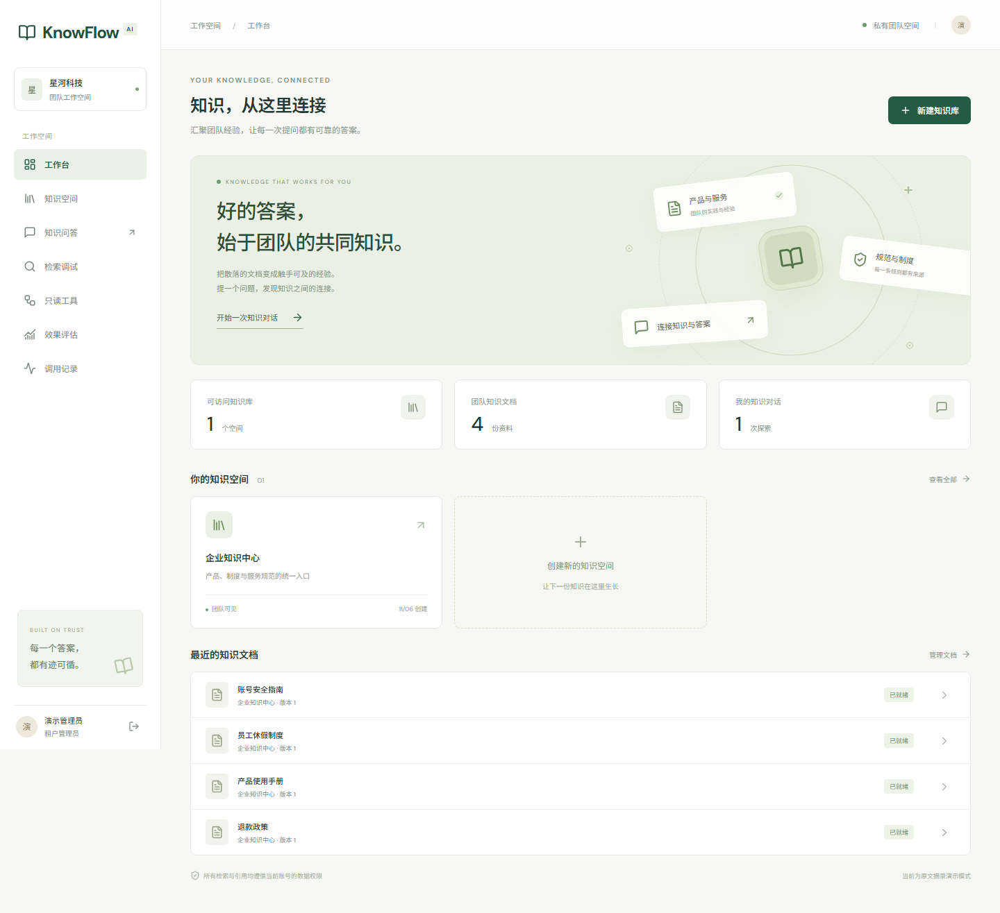

# KnowFlow AI

基于 Django 5.2 / DRF 与 Vue 3 的多租户企业知识库项目。按所提供的技术方案实现了可运行的核心业务链路，并附带中文演示界面、数据库迁移、自动化测试和部署模板。

> 当前版本为开发演示版。默认用本地哈希向量、规则规划和原文摘录演示完整流程，不代表真实语义模型的回答质量。S1–S5 工程交付及新环境备份恢复已完成；持续并发测量中 API/检索延迟未达目标，真实模型与人工语义项仍待验收。见 [逐项验收状态](docs/acceptance.md)。



## 本机快速体验（Windows）

需要 Python 3.12、[uv](https://docs.astral.sh/uv/getting-started/installation/)、Node.js 22。本地演示无需 Docker、Redis 或模型密钥。

在项目根目录运行：

```powershell
.\scripts\start-local.ps1
```

访问 [http://127.0.0.1:5173](http://127.0.0.1:5173)。默认新建账号的演示密码为 `KnowFlowDemo!2026`；也可使用 `-Password '自行设置的密码'`。重复初始化保留已有用户密码。

| 租户 | 管理员 | 普通成员 |
| --- | --- | --- |
| 星河科技 | admin@acme.demo | member@acme.demo |
| 远山实验室 | admin@atlas.demo | member@atlas.demo |

初始化会为每个租户导入四份自编中文资料、36 条业务问题和 20 条召回开发集问题。演示账号只用于本地。租户管理员不能进入 Django 运维后台。

也可以手动启动，先在一个终端运行后端：

```powershell
cd backend
uv sync --frozen --python 3.12
uv run python manage.py migrate
uv run python manage.py seed_demo --password 'KnowFlowDemo!2026'
uv run uvicorn config.asgi:application --host 127.0.0.1 --port 8000
```

另开终端运行前端：

```powershell
cd frontend
npm ci
npm run dev
```

建议先提问“退款超过 30 天还能申请吗？”，再点来源查看原文。也可上传 UTF-8 Markdown/TXT、文本 PDF 或 DOCX，等待“已就绪”后提问。PDF 上限 200 页，单文件上限 20 MB；扫描 PDF 会明确报 `OCR_REQUIRED`。

## 已实现的内容

- 邮箱登录、JWT 刷新轮换/撤销、停用账号检查；单账号归属单租户。
- 租户角色及操作权限；成员创建/停用、角色分配/编辑；知识库用户/角色 ACL、文档继承或进一步收紧的可视化管理。
- 私有/租户可见知识库，上传、授权下载、版本列表、重试、软删除。
- PDF/DOCX/TXT/Markdown 解析、保留原文位置、确定性切片、批量向量化；固定解析子进程墙钟/输出控制和 Linux CPU/内存限制。
- 不可变文件版本及构建配置；数据库任务清单、租约、fencing、重复投递保护、旧版本继续服务。
- 授权范围内的向量/关键词召回、RRF、检索调试；PostgreSQL 路径使用 pgvector 和中文分词后的 `simple` 全文检索。
- ASGI POST SSE、来源引用、无证据拒答、部分答案保存、取消、断流处理、幂等请求、悬挂运行扫描。
- 会话只限创建者访问；历史正文、运行结果及引用重新检查当前文档权限。
- 受控 Agent：模型提出三个白名单只读工具的调用，最多四次执行，单工具 10 秒/总执行 60 秒，独立子进程硬超时、取消、严格参数校验、额度与脱敏审计。
- 文档摘录及业务统计快照均可追溯引用；工具调用和最终回答重新检查当前权限。保留显式单工具调试入口。
- 100 条分层题和独立 50 项安全矩阵；B0/B1/B2 对照、原文范围 gold、EvidenceHit/MRR/Precision、逐题回答与人工复核。
- 可开关的查询改写、独立重排适配器；默认规则/词项对照，外部协议使用受控替身验证；1,000/10,000 Chunk 精确/HNSW 诊断。
- 结构化日志、trace_id、任务状态、模型调用记录、活性/就绪检查。
- SQLite 本地备份恢复、PostgreSQL/私有对象联合快照及全新环境恢复、原文件 SHA-256/业务行摘要核验、可选 TLS、完整 Compose CI。
- 上传对象租约、孤儿清单与两次观察的保留期清理、过期凭据和临时解析目录清理；默认预览，保留所有版本引用的文件。
- 生成/向量服务独立配置、连通性检查、授权历史预算、每日额度、按次原子预留和幂等结算；未知用量与估算费用明确标记。

API 文档见 [docs/api.md](docs/api.md)，实现边界和验收状态见 [docs/implementation-status.md](docs/implementation-status.md)。

后续开发按 [分阶段计划](docs/development-plan.md) 推进。S1–S5 代码和工程验收材料已交付；[S5 实测报告](docs/benchmarks/delivery-2026-11-13.md) 保留 160 项授权、50/20 份文件、重复故障、恢复和两轮持续并发的原始结果。最终 API/检索 P95 为 1.74/2.50 秒，未达 300/800 毫秒目标，下一步优先剖析并复测。S3 入口见 [检索质量说明](docs/retrieval-quality.md)，S4 使用方法见 [受控 Agent](docs/controlled-agent.md)。

[部署与数据运维](docs/operations.md) 包含解析、清理、联合备份/恢复及 HTTPS；[演示流程](docs/demo/walkthrough.md) 附实际录屏和截图。完整 A01–A15 尚未全部通过，真实供应商及人工语义验收继续保留。

## 接入真实模型

复制 `.env.example` 为根目录 `.env`。默认无需此文件即可本地运行。

```dotenv
AI_PROVIDER=compatible
AI_BASE_URL=https://your-provider.example/v1
AI_API_KEY=your-secret
AI_MODEL=your-chat-model
EMBEDDING_PROVIDER=compatible
EMBEDDING_MODEL=your-embedding-model
EMBEDDING_DIMENSIONS=128
```

供应商需要实现 Chat Completions SSE 和 Embeddings 协议。Agent 另要求非流式 Chat Completions 的严格 function calling（`tools`、`tool_choice`、`parallel_tool_calls:false`）。密钥只从服务端环境读取。供应商 usage 缺失时记录 `unknown`，不编造 Token 或成本。上面的 `AI_*` 仍兼容旧配置；生成和向量服务现在可以分别设置地址和密钥，配置方式及预算/结算语义见 [模型接入说明](docs/model-integration.md)。

**向量维度在数据库结构中固定。** 示例初始维度是 128。若所选模型使用其他维度，应先设置环境变量，在新数据库上运行 `uv run python manage.py makemigrations documents` 生成并审阅维度迁移，再迁移及重新导入资料。已有数据需要按独立检索空间迁移，不能直接混用旧向量。profile 改变后旧构建不进入新查询空间，需要重新构建。

每次问题重新检索，并在预算内重放仍有权限且来源版本有效的最近问答。已撤权或已被新版替代的旧答案不会进入模型上下文。可在“调用记录”页检查模型连接和设置每日额度。

## PostgreSQL / Redis / MinIO 部署模板

需要 Docker Compose。本机没有 Docker，完整容器组合已在 [S5 GitHub Actions](https://github.com/ha0018/KnowFlow/actions/runs/43365455447) 从空卷启动，完成十组业务、重复故障、联合备份/新环境恢复和 HTTPS 检查；负载测量也在该运行中完成，延迟目标未通过。

1. 复制 `.env.example` 为 `.env`，替换 `SECRET_KEY`（至少 32 位随机字符）、迁移账号密码 `POSTGRES_PASSWORD`、应用账号密码 `POSTGRES_APP_PASSWORD` 和 MinIO 密码。
2. `.env` 的 `ALLOWED_HOSTS` 加入实际访问域名。默认容器映射本地 HTTP 8080；对外部署请设置 HTTPS 并启用 `SECURE_SSL_REDIRECT`。
3. 运行：

```powershell
docker compose --env-file .env -f deploy/compose.yaml up --build -d
docker compose --env-file .env -f deploy/compose.yaml exec backend uv run --no-sync python manage.py seed_demo --password '自行设置的密码'
```

访问 [http://localhost:8080](http://localhost:8080)。Compose 提供 PostgreSQL 17/pgvector、Redis、MinIO/bucket 初始化、迁移、后端、worker、scheduler 与 Nginx/Vue。迁移为一次性服务，后端等待迁移成功；文档文件不通过公开静态目录提供。SSE 已关闭 Nginx 缓冲。

迁移和应用已使用独立数据库账号，基础镜像固定 digest。MinIO 从固定源码版本构建。完整容器验收由独立 CI 执行；联合备份及 TLS 模板的配置与验收边界见 [运维说明](docs/operations.md)。对外部署需配置实际域名、受信证书及私有备份保管位置。

## 测试与开发

```powershell
cd backend
uv run python manage.py check
uv run python manage.py makemigrations --check --dry-run
uv run ruff check .
uv run ruff format --check .
uv run pytest -q
```

```powershell
cd frontend
npm run build
npm test
# 后端和前端均已启动、演示数据已导入时：
npx playwright install chromium
npx playwright test
```

后端测试默认使用 SQLite。真实 PostgreSQL 集成可设置 `DATABASE_URL` 后运行同一组测试；GitHub Actions 的两种数据库矩阵及整套 Compose 验收均已通过。详细结果见 [docs/verification.md](docs/verification.md)。

导出开发集逐题召回报告：

```powershell
cd backend
uv run python manage.py evaluate_demo --mode hybrid --output ../evals/reports/demo-hybrid.json
```

## 备份与恢复（本地模式）

```powershell
cd backend
uv run python manage.py backup_local --output ../.runtime/backup.zip
uv run python manage.py restore_local --archive ../.runtime/backup.zip --destination ../.runtime/restored
```

该命令使用 SQLite 在线备份 API，归档数据库快照内引用的本地文件及校验清单。恢复只允许写入新的空目录，先核验所有哈希和路径，再写入；不会覆盖运行中的数据库。可用 `.env` 的 `DATABASE_URL` 与 `MEDIA_ROOT` 指向恢复副本。包含账号和原文的备份需妥善保管。PostgreSQL/S3 部署使用 [联合快照和新环境恢复流程](docs/operations.md)，本地命令不适用。

## 结构

```text
backend/
  config/              设置、ASGI、路由、Celery
  apps/                users / knowledge / documents / conversations
                       agents / evaluation / monitoring
  common/              显式上下文、认证、日志、审计
  ai_engine/           解析、切片、向量、检索、生成网关
  tests/               权限、任务、流式、认证、工具、评估、备份
frontend/              Vue 3 + TypeScript + Pinia + Vue Router
deploy/                Dockerfile、Compose、Nginx
docs/                  架构、API、ADR、验收与截图
evals/                 数据集说明与实验报告
scripts/               Windows 本地启动
```
