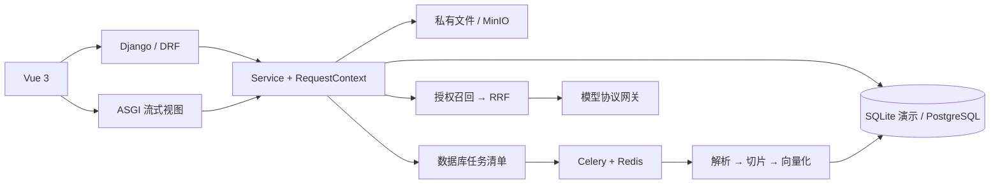

# 架构与数据边界

普通 API 采用 DRF；流式路由使用 Django 原生异步视图与异步生成器，短数据库操作由 `sync_to_async` 调度。所有业务入口构造 `RequestContext`，用户身份决定租户；请求和工具参数不接收租户身份覆盖。

角色控制创建知识库、执行工具、评估和监控等操作。知识库所有者和租户管理员具有管理范围；文档访问必须先满足知识库权限，`restricted` 文档再要求文档 ACL。授权查询直接约束 ORM，检索、下载、任务、工具及历史引用复用这些查询。

PostgreSQL 迁移添加 `(tenant_id,id)` 唯一约束及复合外键；SQLite 用触发器拒绝跨租户关联。附加触发器约束 active/desired build 的文档归属、Chunk 的 KB/文档/构建一致性，冻结文件版本和来源归属。租户归属不允许原地修改。服务端权限校验仍然必要，数据库引用约束不能替代 ACL。

文档处理在短事务中创建版本、构建和任务，然后提交后投递。Redis 不可用时保留数据库清单；每 30 秒补投。领取任务会递增 fence token，后续阶段、写入和发布都检查该 token。构建期间旧 active build 继续检索。只有仍被 desired build 指针选择的完整构建才能发布。副作用以数据库约束和比较更新兜底，队列不宣称 exactly-once。

会话只允许创建者读取。回答开始前持久化 run 与消息，来源在模型请求前绑定。每秒等待上游时检查取消/ACL epoch，关闭生成器会关闭 HTTP 流。后台扫描中断超过两分钟没有心跳的 run。历史回答只要任一来源失权，整个 assistant 正文隐藏，来源快照不会绕过权限。模型历史仅使用权限和当前发布版本均有效的完整问答对，在独立预算内从最近记录截取，并移除旧来源编号。

生成和向量模型使用独立 profile；显式设置新 endpoint 时不转发旧 key。每个外部请求尝试在短事务中锁定租户并预留额度，事务外访问模型。结算同样按租户/预留顺序加锁，保留供应商实际用量或明确标记的未知预留。过期/已结算预留禁止再次发送，后台扫描以锁内的最新发送状态回收，防止过期调用绕过额度。

文档内容在 Prompt 中作为非可信证据数据。工具只能调用白名单中的只读函数，严格拒绝未知字段及伪造身份。当前工具为显式单次执行；完整模型规划、四步循环及硬超时 runner 尚未实现。

实现参考：[Django ASGI](https://docs.djangoproject.com/en/5.2/howto/deployment/asgi/)、[DRF 权限说明](https://www.django-rest-framework.org/api-guide/permissions/)、[pgvector Python](https://github.com/pgvector/pgvector-python)、[Chat Completions 协议](https://developers.openai.com/api/reference/resources/chat)、[Embeddings 协议](https://developers.openai.com/api/reference/resources/embeddings/methods/create)。
