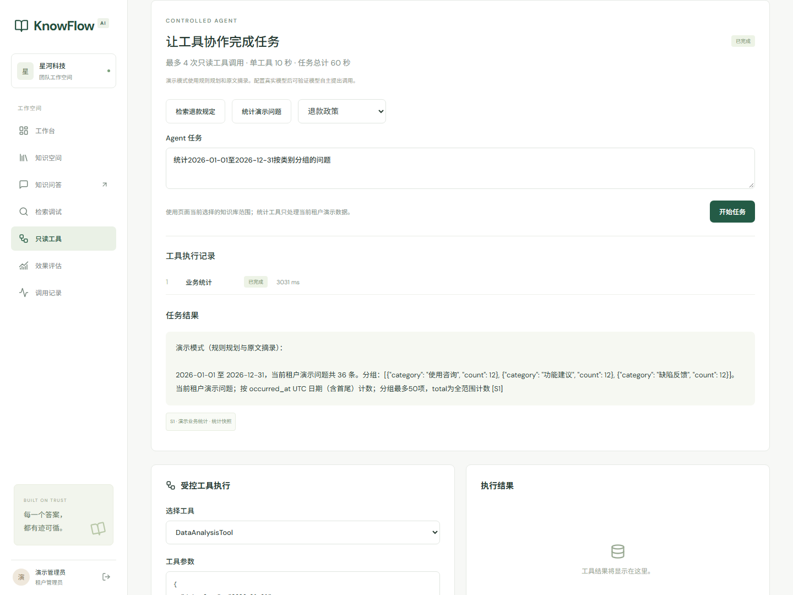

# 受控 Agent

S4 在现有会话、授权、模型 profile 和原子额度账本上增加模型规划及执行循环。界面位于“只读工具”，提供任务输入、资料范围、进度、停止和引用；下方保留单工具调试。默认使用规则规划与摘录演示，外部模型需要支持原生 function calling。

## 本地体验

更新代码后先备份再运行迁移，已有启动流程见 README。进入“只读工具”，选择“企业知识中心”，可以依次执行：

1. “检索退款规定”：查询当前可读资料，打开文档引用。
2. 选择“退款政策”文档：生成有来源的摘录摘要。也可输入“总结退款政策”，演示规则先检索再摘要。
3. “统计演示问题”：对 2026-01-01 至 2026-12-31 的本租户演示问题按类别汇总，打开 JSON 统计快照。

统计仅基于 BusinessIssue 演示数据，当前默认租户各有 36 条；不连接外部生产系统。摘要使用词项 focus 排序的原文摘录，没有调用单独摘要模型。演示规则不是 LLM，自然语言能力不能用来判断供应商规划效果。没有足够当前证据时返回拒答。

## 执行边界

模型只能提出 KnowledgeSearchTool、DocumentSummaryTool、DataAnalysisTool 的调用，身份、租户和权限均从服务端当前账号取得。工具只读；没有任意 Python、SQL、Shell、URL 或文件路径执行接口。严格 schema 拒绝未知字段、重复 JSON 键、NaN、非法 UUID、类型转换、超长查询和越界日期/数量。

一轮最多四次工具执行，各轮至多提出一个调用；重复调用 ID、重复工具及参数签名、并行建议或第五次工具建议均停止。最多五次规划决策（四次工具加最终收尾），每次网络重试仍计入统一时长和额度。前端只展示工具名称、状态、耗时及最终回答，不暴露模型推理过程。

每次合法工具在固定 Python 模块入口的新子进程内执行。父进程通过有界 stdin/stdout 协议传递服务端上下文，子进程从数据库重新验证审计记录和参数哈希，调用固定函数。超时、撤权、停止按钮或 SSE 断开时先关闭模型 HTTP 或 kill/wait 工具进程，再写审计及结算未完成预留，防止工具在返回超时后继续工作。进程启动也消耗工具期限。

总期限覆盖规划、重试、工具执行及证据收集，使用单调时钟；到期立即取消活动执行。数据库持久化、预留结算和系统进程回收属于随后清理，响应完成时间可能超过执行期限。子进程是可信工具的期限隔离，仍使用应用账号及可信环境；不构成任意不可信代码的 CPU/内存/网络沙箱。文档解析隔离仍属于 S5。

## 配置与用量

以下服务端环境变量在开始 run 时冻结；配置越界会被系统检查和运行准入拒绝。

| 配置 | 默认 | 有效范围/含义 |
| --- | --- | --- |
| AGENT_MAX_TOOL_CALLS | 4 | 整数 1–4，最大工具执行数 |
| AGENT_TOOL_TIMEOUT_SECONDS | 10 | 0.1–10 秒，含工具进程启动 |
| AGENT_TOTAL_TIMEOUT_SECONDS | 60 | 0.2–60 秒，整轮活动执行 |
| AGENT_TOKEN_BUDGET | 32000 | 1024–100000，整轮模型用量准入预算 |
| AGENT_EVIDENCE_BYTES | 6000 | 512–12000，累积工具观察的紧凑 JSON UTF-8 字节数 |
| AGENT_OUTPUT_BYTES | 16000 | 512–16000，最终正文 UTF-8 字节上限 |

规划复用 generation endpoint/key/model，调用类型记为 agent_planner；不引入新的密钥。每次规划的输出还受 generation 上限和 800 Token 两者较小值限制，每次模型活动最长 20 秒且受剩余总期限约束。检索中的 Embedding/改写/重排同样进入 run 的 Token 预留预算。输入/schema 使用现有保守 Token 估算，供应商 tokenizer 尚待校准。

额度在租户锁内预留和幂等结算，新的调用检查整轮已扣记及在途预留。供应商实际报告高于预留时仍如实记账，并拒绝后续超预算调用；无法在供应商端保证精确 Token 硬截断。已发送但被中断的未知用量按 S2 策略结算，usage 保持 unknown；尚未发送的预留释放。查看“调用记录”中的 agent_planner/embedding 等元数据及相应 trace_id。

## 引用、授权与输出

调用前后、证据收集、最终提交均重新读取当前用户/租户状态、agent.execute、ACL epoch 和文档发布版本。摘要限定在会话知识库范围内；检索不能利用工具参数扩大范围。撤权会终止活动 run，历史回答及引用按当前权限隐藏。

文档证据复用不可变版本的 MessageReference，单来源摘录最多 1,200 UTF-8 字节，位置随截断调整。摘要最多检查 80 个 Chunk、返回八个片段；统计最多返回 50 个分组，总数仍为完整范围计数。证据预算进一步截断时保留 truncated/groups_truncated 标记，不把未返回的分组描述为完整列表。

统计证据保存在 ToolCall.result_summary 中，包含时间范围、筛选、演示口径及 captured_at，统一分配 S 编号。引用接口仅对本人、当前能力和相同 ACL epoch 可用；任意租户 ACL epoch 变化会保守隐藏旧快照及含该快照的整个答案。快照代表当时查询结果，不承诺自动刷新。

最终回答必须使用实际已收集的 S 编号；未知或缺失引用停止回答。这只验证来源编号存在及当前可见，语义支撑率仍需人工/真实模型评测。通过当前授权和引用检查后原子保存最终正文，再拆分 SSE delta；规划和最终生成本身使用非流式 JSON 请求。原有普通 RAG 的上游 Token 流保持原实现。

## 审计与停止原因

ToolCall 记录 actor/run、步骤、工具名、参数哈希、脱敏参数、状态、耗时、错误码、trace_id、权限快照和结束时间。query/focus/product 以 SHA-256 与长度替代原文；常规元数据接口不返回原始问题或工具全文。数据库禁止修改审计归属、调用身份及参数标识，并约束 actor 与 run 所有者一致。

常见停止码包括 TOOL_TIMEOUT、AGENT_TIMEOUT、AGENT_STEP_LIMIT、AGENT_TOOL_LOOP、AGENT_PARALLEL_CALL_REJECTED、AGENT_TOKEN_BUDGET_EXCEEDED、AGENT_EVIDENCE_BUDGET_EXCEEDED、AGENT_CITATION_INVALID、PERMISSION_CHANGED。具体 code 和 trace_id 以 GET run/工具审计为准。停止按钮复用 POST `/runs/{id}/cancel`，重复提交通过 Idempotency-Key 返回已有运行，不续播 SSE。

## 验收与剩余工作

[S4 报告](benchmarks/controlled-agent-2026-11-13.md) 包含 SQLite/PostgreSQL 的原始 JUnit、真实工具进程超时/取消、实际 socket 协议、Nginx 容器链路和浏览器结果。真实供应商还需要配置、冻结模型版本后验证三种工具选择/多步规划、实际取消用量、引用语义支撑及拒答/注入效果。现有 HTTP 替身仅证明协议边界，未替代这些质量验收。

function-calling 协议参考 [官方指南](https://developers.openai.com/api/docs/guides/function-calling) 及 [Chat Completions API](https://developers.openai.com/api/reference/resources/chat/subresources/completions/methods/create)。工具使用 strict:true、完整 required 列表、可选字段 nullable、additionalProperties:false，并关闭 parallel_tool_calls；服务端仍独立校验。
