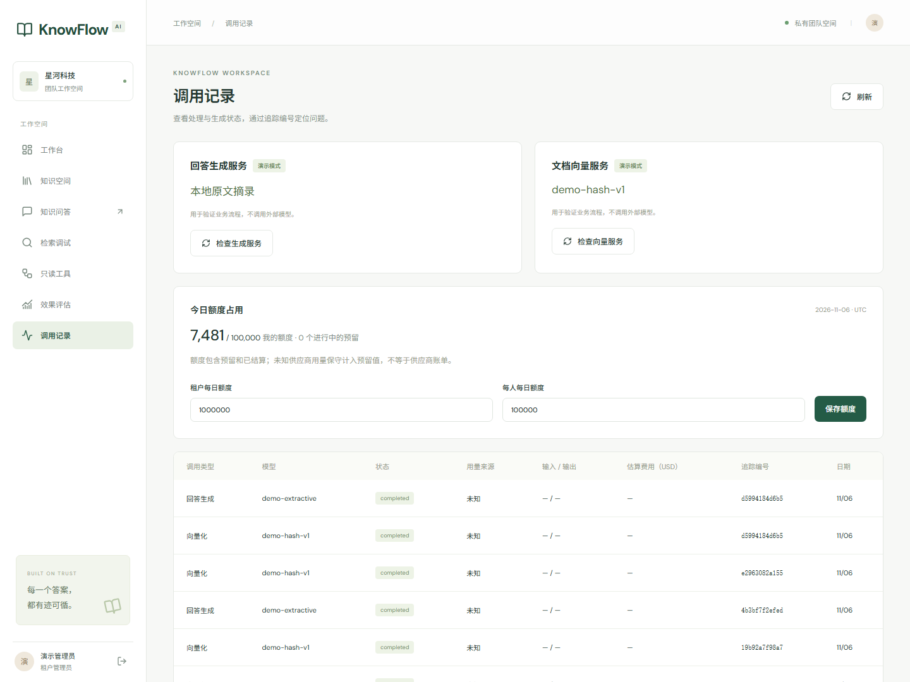

# S2：模型接入与资源控制

当前已实现独立模型配置、协议探测、输入预算、授权历史、原子额度预留与结算。真实供应商尚未配置，本阶段的供应商/模型版本冻结与真实回答验收仍待执行。协议测试使用受控 HTTP 服务，不代表 LLM 效果或供应商服务质量。

代码修订 `ecd047e` 的自动检查与完整容器验收均通过，结果见 [S2 验证报告](benchmarks/model-resources-2026-11-06.json)。



## 独立配置

将 `.env.example` 复制为根目录 `.env`，在服务端填写：

```dotenv
GENERATION_PROVIDER=compatible
GENERATION_BASE_URL=https://your-generation-provider.example/v1
GENERATION_API_KEY=your-generation-secret
GENERATION_MODEL=your-generation-model
GENERATION_TOKEN_PARAMETER=max_completion_tokens

EMBEDDING_PROVIDER=compatible
EMBEDDING_BASE_URL=https://your-embedding-provider.example/v1
EMBEDDING_API_KEY=your-embedding-secret
EMBEDDING_MODEL=your-embedding-model
EMBEDDING_DIMENSIONS=128
EMBEDDING_SEND_DIMENSIONS=false
EMBEDDING_PROFILE_VERSION=v1
```

供应商需要支持 Chat Completions SSE 或 Embeddings 的对应协议；两者可使用不同服务和密钥。仅支持旧版 `max_tokens` 的服务可设置 `GENERATION_TOKEN_PARAMETER=max_tokens`。生成请求不强制设置 temperature，以免与部分推理模型的参数限制冲突。

自托管、无认证服务可以显式设置对应的 `*_AUTH_REQUIRED=false`。独立 endpoint 未配置 key 时不会自动转发旧 `AI_API_KEY`；只有 endpoint 也沿用旧配置时才保留旧版 key 回退。浏览器只能看到配置状态和模型名称，不能读取 endpoint、key 或修改任意请求地址。

## 向量空间与维度

初始数据库列为 `vector(128)`。模型 profile 包含 provider、model、维度、手工版本、endpoint 指纹和维度请求选项。轮换 key 不改变检索空间；更换模型、地址、版本或维度会要求新的构建。

如果模型明确支持自定义输出维度，可设置 `EMBEDDING_SEND_DIMENSIONS=true` 请求所配置的 D；否则保持 false 并使用该模型真实输出维度。不能假定所有模型都支持 dimensions 参数。

`probe_models` 会比较实际数据库列类型与配置维度，不一致时拒绝向量探测。需要其他维度时，应先在新数据库/新检索空间中冻结 D，生成并审阅 documents 的维度迁移，完成迁移后再导入资料。不要直接把不同维度的新向量写入已有 128 维索引。已有引用和旧数据的迁移/清理应单独设计。

## 配置检查与网络探测

```powershell
cd backend
uv run python manage.py check
# 不请求外部模型：检查配置、预算和数据库维度
uv run python manage.py probe_models --report ../.runtime/model-configuration.json
# 明确发起公开测试文本，计入指定用户/租户的额度
uv run python manage.py probe_models --live --email admin@acme.demo --report ../.runtime/model-probe.json
```

也可在“调用记录”页分别检查生成和向量服务。探测报告只保留状态、模型名称、profile、维度、usage 来源与耗时，不保存 key、完整地址或模型原始回答。demo 模式不会被标为真实协议验证。

## 输入、历史和输出预算

默认上下文上限 16,384，输入预算 12,000，历史预算 2,000，输出上限 800。配置必须满足输入预算 + 输出上限不超过上下文上限。

本地预算使用确定性的 UTF-8 字节估算加消息封装余量，标识为 `utf8-upper-bound-v1`。这是一种保守的准入策略，不是供应商 tokenizer 的精确计数，可能比实际 Token 数高。当前问题和本轮证据优先；超预算的问题明确拒绝，证据按可容纳的片段保留，历史按最近的完整问答对截取。输出上限通过供应商支持的 Token 参数发送。

每次运行重新检索。历史回答只有在全部来源仍可读、仍指向当前发布构建时才可重放；旧 source ID 会被移除，历史明确标记为非本轮证据。已撤权或旧版来源对应的整对历史不会发送给模型。每次重试发送前再次检查运行/授权状态。

## 额度与结算语义

- 每次查询向量化、文档批量向量化及生成调用分别预留额度。HTTP 重试产生独立预留和日志，避免掩盖失败尝试可能产生的费用。
- 默认每日租户额度 1,000,000、每人 100,000；管理员可在“调用记录”页或 `/monitoring/quota` 更新。额度为零表示拒绝新调用。
- 预留事务锁定租户行，按 UTC 日期同时检查租户和用户的已结算/进行中占用，网络请求在事务外执行。PostgreSQL 并发测试验证不会同时超额准入。
- 供应商报告有效 total_tokens 时据此结算，释放未用部分。实际值高于预留时仍保留实际值，后续请求会受剩余额度约束，不伪造较低用量。
- 已发送但未获得有效 usage 的调用（含断流、超时、取消）保守计入完整预留，标为 `reserved_unknown`；这是内部额度策略，不是已知的供应商账单。
- 明确拒绝的 4xx/429 请求释放预留；本地 demo 仅按内部估算记额度，不生成供应商 Token 或费用。未发送的失败调用释放预留。
- 结算幂等；超时遗留的预留由后台扫描回收。已发送的遗留记录按未知用量保守结算，未发送的记录释放。记录保留原先的 UTC 日期。
- 发送前重新锁定预留并检查有效期；已过期或已结算的记录不能继续发起上游调用。回收同样使用锁内最新发送状态，避免陈旧扫描错误释放额度。

模型价格为空时费用为未知。可配置输入/输出每百万 Token 的 USD 单价及 `MODEL_PRICE_VERSION`；仅在供应商有效用量和对应价格都齐全时记录估算费用。调用日志保留调用时的价格快照，不以今日价格改写历史。

## 错误、重试与关闭

错误仅返回安全代码，如 `MODEL_NOT_CONFIGURED`、`MODEL_AUTH_FAILED`、`MODEL_RATE_LIMITED`、`MODEL_TIMEOUT`、`MODEL_STREAM_INTERRUPTED`、`EMBEDDING_VECTOR_INVALID`、`QUOTA_EXCEEDED`。上游错误正文、认证头和密钥不进入响应/日志。

临时错误最多重试两次，尊重可等待范围内的 Retry-After；等待超出当前预算时返回限流错误。生成一旦输出正文就不重放。同步向量入口通过独立异步 HTTP 请求实现总超时，流式生成逐次读取受绝对期限限制；取消会关闭上游连接并结算预留。整个问答还受 `AI_TIMEOUT_SECONDS` 总时限约束。

接口事实参考：[Chat Completions](https://developers.openai.com/api/reference/resources/chat/subresources/completions/methods/create)、[Embeddings](https://developers.openai.com/api/reference/resources/embeddings/methods/create)、[Token 计数说明](https://developers.openai.com/api/docs/guides/token-counting)。
